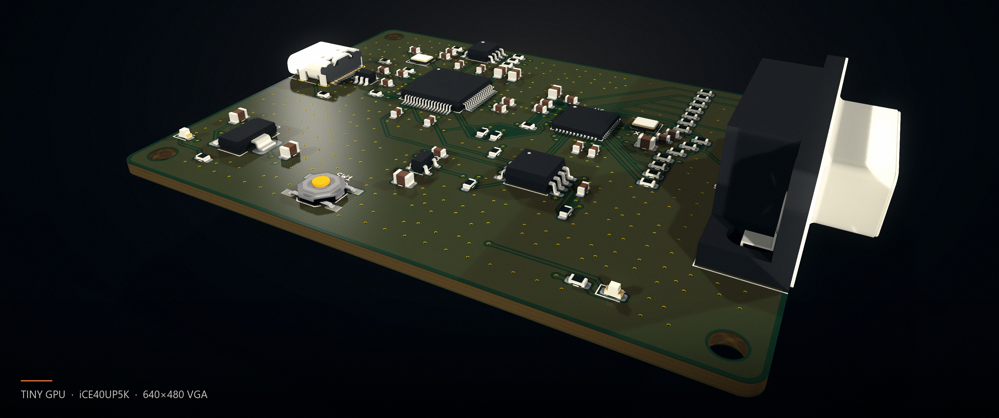
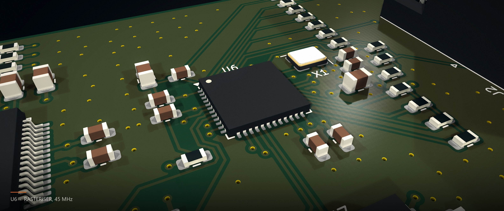
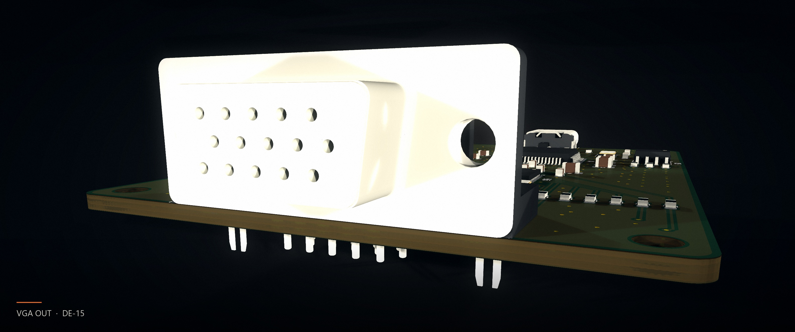

# Tiny GPU

A small triangle-rasterising GPU written in Verilog for the Lattice iCE40UP5K FPGA, plus the
4-layer board it would run on. A laptop sends triangles over USB, and the GPU fills them into
a framebuffer and drives a VGA monitor at 640×480, 60 Hz.

The board is a design only: it is fully routed and passes KiCad's checks, but it hasn't been
built.



## How it works

```
laptop ──USB──► FT2232H ──UART 1 Mbaud──► command FIFO ──► rasteriser ──► framebuffer ──► VGA
                                                                          64×64, 4-bit    640×480
```

- **Rasteriser** (`rtl/raster.v`): fills one pixel per clock using edge functions. Each edge
  steps by a single add per pixel, so the scan loop has no multipliers. Setup, which does
  need multiplies, is pipelined over seven clocks and runs on the FPGA's DSP blocks.
- **Framebuffer** (`rtl/framebuffer.v`): 64×64 pixels, 4 bits each, in block RAM. One port is
  for drawing and one for the display.
- **VGA** (`rtl/vga.v`): 640×480 at 60 Hz from a 25.125 MHz PLL clock. Each framebuffer
  pixel is drawn as a 7×7 block, giving a 448×448 picture centred on screen. A 16-colour
  palette feeds a 4-bit resistor DAC per channel.
- **Tear-free presenting:** `PRESENT` waits for vertical blank before it reports the frame
  done, so the host draws the next frame while the beam is off screen.
- **Host link** (`rtl/uart.v`, `rtl/cmd_port.v`): 8-byte commands at 1 Mbaud through a
  512-byte FIFO.

### Commands

Each command is 8 bytes: `0x55, op << 4 | colour, x0, y0, x1, y1, x2, y2`. Coordinates are
signed 8-bit, so vertices can sit off screen.

| op | Name     | What it does                                                    |
|----|----------|-----------------------------------------------------------------|
| 0  | CLEAR    | Fill the framebuffer with `colour`                              |
| 1  | TRIANGLE | Fill the triangle with `colour`                                 |
| 2  | PRESENT  | Wait for vertical blank, then reply `0x06`                      |

`host/spin.py` uses these to draw a spinning scene at 60 Hz.

### Results

- Both testbenches pass. `tb/tb.v` draws 48 frames on the core. `tb/tb_board.v` drives the
  whole design from its pins, as the laptop would over UART, then captures a VGA frame from
  the sync and colour pins and checks all 307,200 pixels.
- Synthesis uses 1,112 LUTs and 8 DSPs.
- Timing closes at 45.2 MHz against the 25.125 MHz needed.

## The board



76 × 56 mm, 4 layers (signal, ground, 3.3 V, signal):

- **iCE40UP5K** (QFN-48) with a 12 MHz oscillator and **W25Q128** configuration flash
- **FT2232H** USB bridge: channel A programs the flash, channel B carries the UART link
- **USB-C** power with ESD protection, **AMS1117** 3.3 V and **AP2112K** 1.2 V regulators
- **VGA** connector, fed by a 4-bit binary-weighted resistor DAC on each of red, green and blue

The board is generated from code. `pcb/gen/design.py` lists every part and net, and
`pcb/make_board.sh` turns it into the KiCad schematic and board:

1. Writes the schematic and runs ERC.
2. Places parts, sets up the stackup and drops a via from every ground and 3.3 V pad to its
   plane.
3. Autoroutes with Freerouting.
4. Finishes any nets Freerouting left with a small maze router that rips up and reroutes
   nearby nets (`pcb/gen/finish_routes.py`).
5. Adds ground pours and stitching vias, removes dangling stubs and fills zones.
6. Runs DRC with schematic parity and exports the schematic PDF.

The result has no unconnected pads and no clearance errors, and it matches the schematic.
The schematic is in [`pcb/tiny_gpu_schematic.pdf`](pcb/tiny_gpu_schematic.pdf).



## Building

Tools: Icarus Verilog, Yosys, nextpnr-ice40 and icestorm for the FPGA. For the board you need
KiCad 10, Java 17 with Freerouting 1.9, and Python with Pillow and NumPy for the renders. The
tool paths at the top of each script point at a Windows/MSYS2 setup, so change them to match
yours.

```bash
./build.sh               # simulate, synthesise, place and route, pack build/gpu.bin
./build.sh sim           # simulations only
pcb/make_board.sh        # regenerate, route and check the board
pcb/render_cinematic.sh  # cinematic renders (add "draft" for quick previews)
```

Freerouting doesn't route the same way every time, so a fresh `make_board.sh` run gives a
slightly different layout, which the finishing steps complete.

## Layout

```
rtl/        Verilog: rasteriser, framebuffer, GPU core, VGA, UART, command port, top level
tb/         testbenches for the core and the whole board
host/       Python driver for the laptop
board.pcf   FPGA pin map
pcb/        KiCad project, generator scripts, schematic PDF and renders
```
